# StromX — V-Strom Instrument Link

[](https://developer.android.com)
[](https://developer.android.com/jetpack/compose)
[](FINDINGS.md)
[](LICENSE)

An open-source Android companion app for the **Suzuki V-Strom SX** (250 cc adventure tourer).

StromX connects directly over Bluetooth Low Energy (BLE) to the bike's instrument cluster without relying on the official Suzuki Ride Connect app. With a calm, iOS-style interface in light or pitch-black mode, it shows sunlight-readable telemetry, provides intelligent self-learning fuel and range estimation, tracks ride history and scheduled maintenance, and forwards Google Maps turn-by-turn navigation directly to the cluster's dot-matrix screen.

Protocol reverse-engineering notes, frame structures, and packet captures are documented in [FINDINGS.md](FINDINGS.md). Full UI styling principles and component rules are detailed in [DESIGN.md](DESIGN.md).

---

## Highlights

- **Direct Cluster Communication**: Communicates directly with the bike's GATT characteristics (`0xFFF0` service: `0xFFF1` write, `0xFFF2` notify) without cloud accounts or the proprietary Suzuki app.
- **Hidden Telemetry Unlocked**: Extracts and surfaces readings the stock app discards, including raw engine temperature reported in real time from byte 25.
- **Calm, Glanceable Interface**: Four tabs, large titles, grouped cards and the Geist typeface, with a single electric-blue accent (`#2391FF`). Light, pitch-black (AMOLED) or system appearance. All controls are sized for motorcycle gloves (minimum 56 dp targets).
- **Engine Overheat Warning**: The engine card turns blood red at 150 °C and tells you to pull over.
- **Always-On Ride Display**: While connected, the phone can dim to a black screen with speed, the next turn and fuel instead of sleeping.
- **Adaptive Fuel & Range Learning**: Because the cluster provides bar levels (1–6) rather than fuel consumption, StromX anchors to full fill-ups, learns the actual remaining fuel capacity corresponding to each gauge bar on your bike, and computes real-time fuel volume and range estimates with confidence intervals.
- **Turn-by-Turn Navigation Forwarding**: Automatically parses Google Maps navigation notifications and streams distance, direction arrows, and ETAs directly to the bike's dot-matrix display.
---

## Screenshots

> These are renders of the approved design mockups, not captures from a device. They will be replaced with real screenshots once the redesigned app has been built and run on a phone.

| Ride | Ride (black) | Engine overheating |
|:---:|:---:|:---:|
| 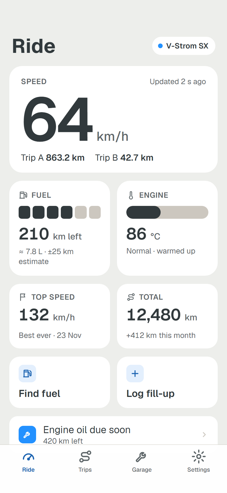 | 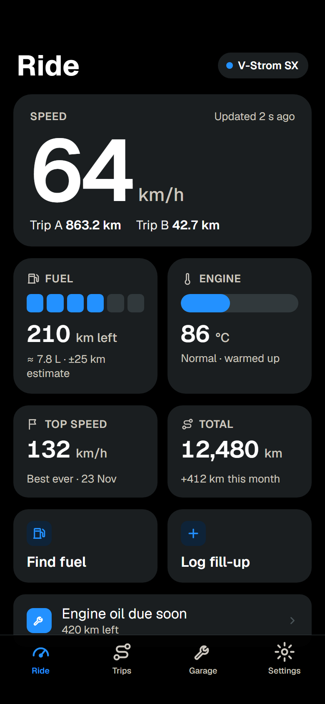 | 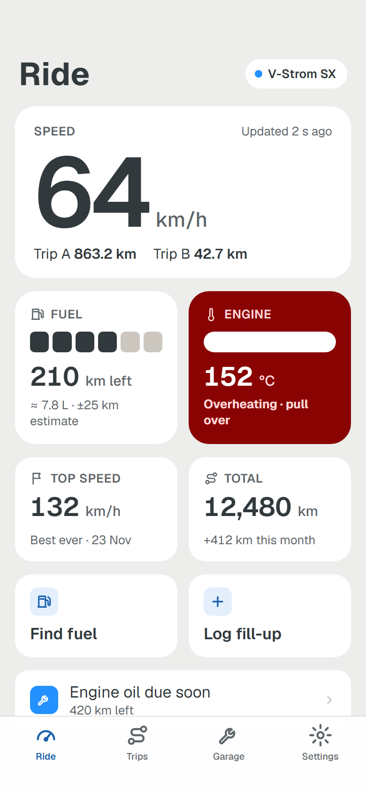 |

| Trips | Garage · Fuel | Garage · Service |
|:---:|:---:|:---:|
| 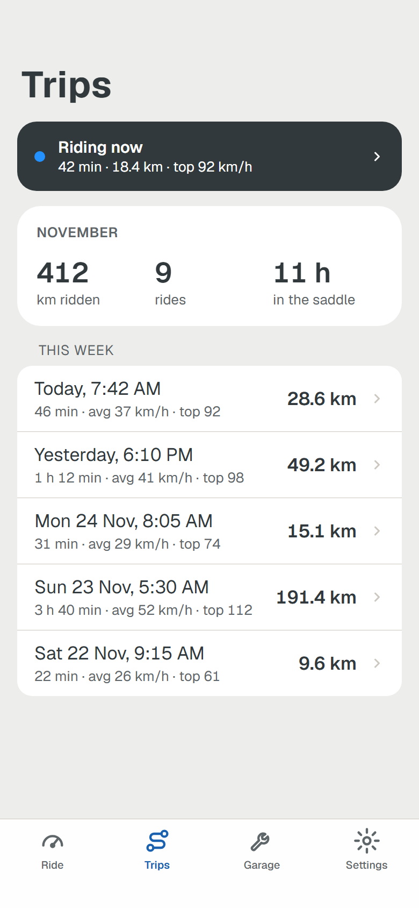 | 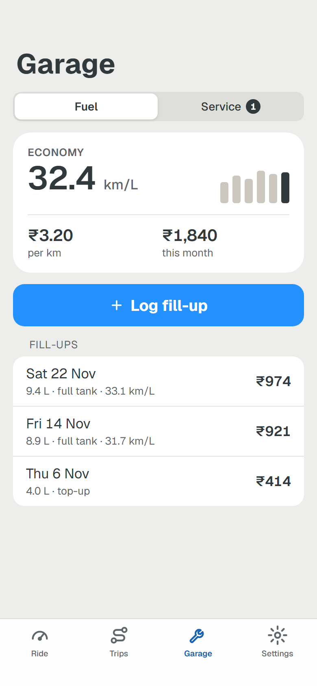 | 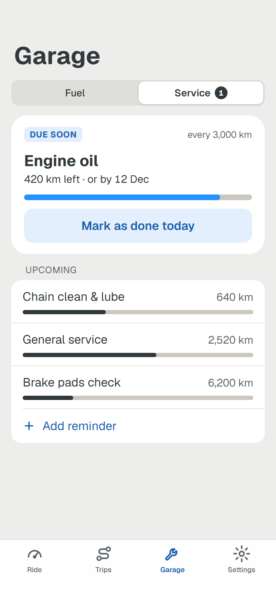 |

| Log fill-up | Settings | Settings (black) |
|:---:|:---:|:---:|
| 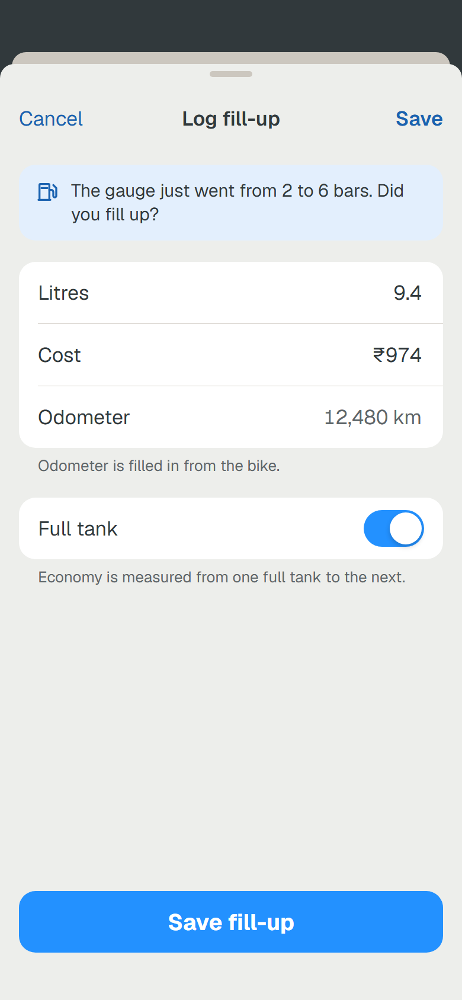 | 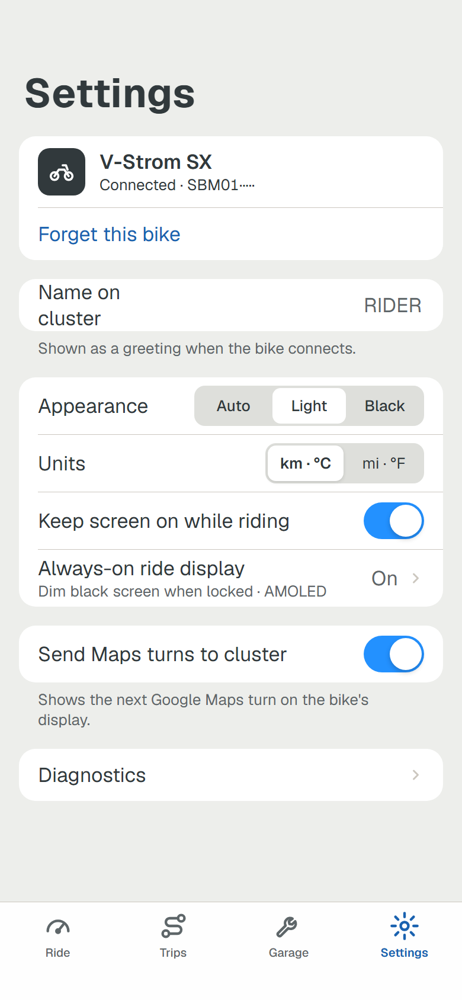 | 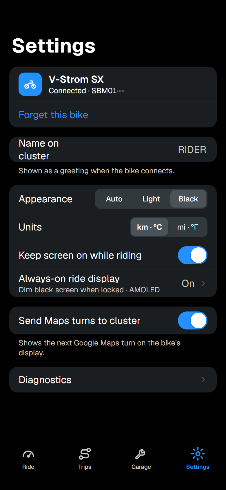 |

| Looking for the bike | Always-on ride display |
|:---:|:---:|
| 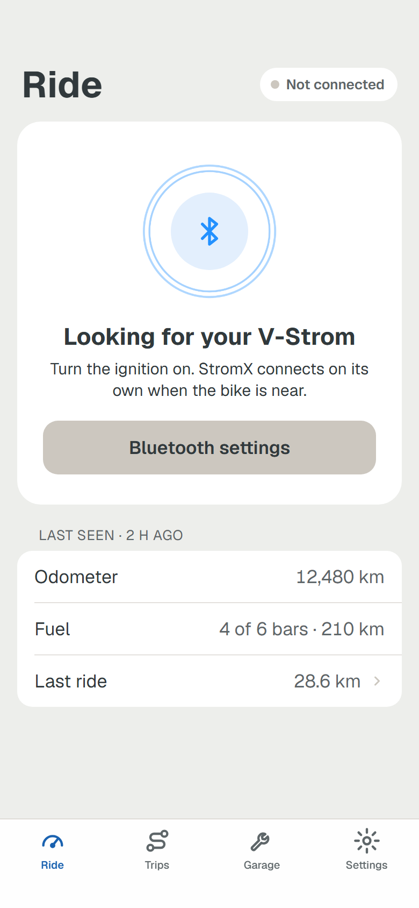 | 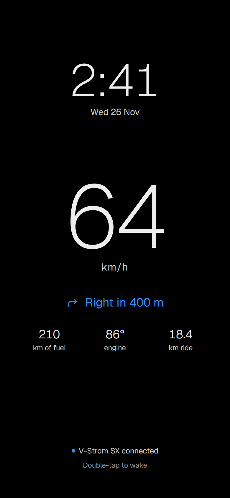 |

---

## App Tabs & Features

| Tab | Key Features |
|---|---|
| **Ride** | • Live speed with Trip A and Trip B; numbers dim and say "No update" if data stops arriving.<br>• 6-bar fuel gauge with range and an honest `± km` margin.<br>• Engine temperature card that turns blood red at 150 °C.<br>• All-time top speed and total distance, with this month's kilometres.<br>• Find fuel and Log fill-up shortcuts, and the next service when it's due.<br>• Without the bike: a "Looking for your V-Strom" card and what the bike last reported. |
| **Trips** | • Start, stop or discard a ride; rides survive app restarts.<br>• Live elapsed time, distance and top speed while riding.<br>• This month's distance, rides and hours.<br>• Ride history with average speed, top speed and estimated fuel used. |
| **Garage** | **Fuel**: fill-up logging (odometer filled in from the bike), full-tank to full-tank economy, cost per km and monthly spend. A fill-up prompt appears when the gauge rises by 2 or more bars, and range is learned bar by bar.<br>**Service**: reminders by distance and/or time with presets, countdown bars, "Mark as done today", and Android notifications when they come due. |
| **Settings** | • Paired bike, fuel tank size, and the rider name sent to the cluster as a greeting.<br>• Appearance (Auto, Light or Black), units (km/°C or mi/°F) and keep screen on.<br>• Always-on ride display, with a preview.<br>• Google Maps turns on the cluster, with the notification access status.<br>• **Diagnostics**: GATT state, last frame, verbose BLE logging, copy/share/clear log, and the cluster arrow test. |

---

## Cluster Telemetry & BLE Protocol

The V-Strom SX cluster transmits a 30-byte telemetry frame on GATT characteristic `0000fff2-0000-1000-8000-00805f9b34fb` every 5 seconds (±30 ms):

```
Byte Offset:   [0]    [1]    [2..4]    [5..10]    [11..16]   [17..22]   [23]   [24]     [25]     [26..27]   [28]       [29]
Payload:      0xA5   '7'     Speed     Odometer    Trip A     Trip B     'N'    Fuel     Engine    0xFF 0xFF  Checksum   0x7F
Format:       Start  Cmd     3 ASCII   6 ASCII     6 ASCII    6 ASCII    Sep    1..6     °C byte   Padding    Sum & FF   End
```

### Telemetry Breakdown

- **Speed (`[2..4]`)**: 3-digit ASCII integer in km/h (`000` to `199`).
- **Odometer (`[5..10]`)**: 6-digit ASCII integer in cumulative kilometres.
- **Trip A / Trip B (`[11..16]`, `[17..22]`)**: 6-digit ASCII integers in tenths of a kilometre (e.g., `008632` = 863.2 km).
- **Fuel Bars (`[24]`)**: ASCII character `'1'` through `'6'` corresponding to the LCD gauge bars.
- **Engine Temperature (`[25]`)**: Unsigned 8-bit integer (°C). Real-world ride data confirms this climbs from ambient (27 °C) to operating temperature (88–90 °C) and cools when stopped.
- **Checksum (`[28]`)**: For V-Strom SX models (`SBM01...` device name prefix), the cluster uses **Plain Sum** checksum mode:
  $$\text{checksum} = \left(\sum_{i=1}^{27} \text{byte}[i]\right) \ \& \ 0\text{xFF}$$
  *(Other Suzuki models use ones' complement `~sum & 0xFF`).*

### Downlink Commands (Phone → Cluster FFF1)

- **Command `'1'` (Navigation Step)**: Streams turn maneuver byte, distance to turn, unit (`M`/`K`), and ETA clock time parsed from Google Maps notifications.
- **Command `'1'` / `'5'` (Display Text)**: Dot-matrix text display updates.
- **Command `'6'` (Identity)**: Transmits rider name to the cluster upon establishing the BLE connection.

---

## Architecture & Project Structure

The project is built using modern Android Jetpack libraries: Kotlin Coroutines, StateFlow, Navigation, Material 3, and Compose.

```
app/src/main/java/com/adithyapaib/stromx/
├── MainActivity.kt               # Entry point, Bluetooth permission requests & lifecycle bindings
├── ble/                          # Bluetooth Low Energy protocol layer
│   ├── BleManager.kt             # Scanning, GATT connection lifecycle, MTU negotiation, CCCD subscription
│   ├── BleViewModel.kt           # BLE state container, error streams, telemetry Flow
│   ├── ClusterWriter.kt          # Serialized GATT writes to characteristic FFF1
│   ├── SuzukiChecksum.kt         # Plain-sum and ones'-complement checksum calculators
│   ├── SuzukiCommandPacket.kt    # Packet encoders for commands '1', '4', '6'
│   ├── SuzukiPacketParser.kt     # Strict 30-byte frame validator & parser
│   └── VStromTelemetry.kt        # Immutable telemetry data model
├── garage/                       # Persistent motorcycle stats & analytics
│   ├── Fuel.kt                   # Fuel fill-up entity & cost calculators
│   ├── FuelEstimator.kt          # Self-calibrating bar learning & remaining range estimator
│   ├── GarageStore.kt            # SharedPreferences JSON persistence for rides & maintenance
│   ├── GarageViewModel.kt        # Coordination between live telemetry, logs, and services
│   ├── Maintenance.kt            # Service interval definitions & countdown logic
│   └── ServiceNotifier.kt        # Android notifications for upcoming/due maintenance
├── nav/                          # Google Maps navigation bridge
│   ├── GoogleMapsNotificationParser.kt # Extracts turns, distances, and ETAs from Maps notifications
│   ├── Maneuver.kt               # Maps instruction strings to Suzuki cluster icon codes
│   ├── MapsNotificationListener.kt     # Android NotificationListenerService implementation
│   ├── NavigationBus.kt          # Reactive broadcast bus decoupling nav events from BLE
│   └── NavigationController.kt   # Periodic transmission loop for turn frames
├── ride/                         # Ride records & event log
│   ├── Rides.kt                  # Ride session tracker, trip distances, and speed stats
│   └── Roadbook.kt               # Generates roadbook event rows from telemetry changes
├── settings/                     # User preferences
│   └── AppSettings.kt            # Units, appearance, always-on, wake lock, rider name, paired bike
└── ui/                           # Jetpack Compose UI layer
    ├── StromXApp.kt              # Four-tab shell, sheets, always-on display switching, haptics
    ├── Format.kt                 # Number, distance, and temperature formatting helpers
    ├── Dates.kt                  # Date and time labels ("Today, 7:42 AM")
    ├── components/               # Shared parts
    │   ├── Icons.kt              # Outline icon set drawn from SVG paths
    │   └── Ui.kt                 # Cards, grouped lists, segmented control, switches, buttons, gauges
    ├── screens/
    │   ├── RideScreen.kt         # Live telemetry, engine warning, top speed, "looking for bike"
    │   ├── TripsScreen.kt        # Ride recording and history
    │   ├── GarageScreen.kt       # Fuel log and service reminders
    │   ├── Sheets.kt             # Log fill-up and new reminder bottom sheets
    │   ├── SettingsScreen.kt     # Preferences, appearance, Maps turns, pairing
    │   ├── DiagnosticsScreen.kt  # BLE state, raw log, cluster arrow test
    │   └── AodScreen.kt          # Always-on ride display
    └── theme/                    # Palette, light and black schemes, Geist type scale
```

---

## Design System

Full rules are in [DESIGN.md](DESIGN.md). In short:

- **Palette**: white `#FFFFFF`, silver light `#EDEEEB`, heather gray `#CCC7BF`, dark night `#31393C` and electric blue `#2391FF`, plus blood red `#8A0303` reserved for the engine overheat warning.
- **Light and pitch black**: Black mode uses true `#000000` for AMOLED screens; gauges light up in electric blue.
- **Typography**: Geist throughout (bundled, SIL OFL), sized like iOS text styles, with tabular figures for every changing number.
- **Sunlight and gloves**: high-contrast text, one big reading per card, and 56 dp minimum touch targets.

---

## Getting Started

### Prerequisites

- **Android Device**: Android 13.0 (API 33) or higher with Bluetooth Low Energy support.
- **Java Development Kit**: JDK 21.
- **Android SDK**: Platform API 36 (build-tools 36.0.0).

### Building from Source

Clone the repository and build using Gradle:

```bash
# Clone the repository
git clone https://github.com/adithyapaib/stromx.git
cd stromx

# Make gradlew executable
chmod +x gradlew

# Run unit tests
./gradlew :app:testDebugUnitTest

# Assemble debug APK
./gradlew :app:assembleDebug
```

The resulting APK will be generated at:
`app/build/outputs/apk/debug/app-debug.apk`

### Device Setup & Pairing

1. **Permissions**: On initial launch, grant **Nearby Devices (Bluetooth)** permissions.
2. **Cluster Auto-Discovery**:
   - Turn on the bike's ignition.
   - Tap **CONNECT** on the Ride tab.
   - StromX scans for Suzuki clusters matching advertised name patterns (`SBM01...`, `SA...`, `SB...`, `SC...`) and automatically connects.
   - Once connected, the app pairs and remembers your bike's MAC address for immediate reconnection.
3. **Turn-by-Turn Navigation Setup**:
   - Navigate to **Settings > Turn-by-Turn Navigation**.
   - Tap **Enable Notification Access** and grant permissions to StromX.
   - Start navigation in Google Maps; directions and distance will begin appearing on the bike's dot-matrix screen.
4. **Mounting**:
   - Rotate the phone horizontally on a handlebar mount to automatically switch to the dual-column cockpit view with the navigation rail.

---

## Unit Testing

StromX includes test suites verifying protocol parsing, checksum calculations, and analytics:

```bash
./gradlew :app:testDebugUnitTest
```

Key test coverage includes:
- `SuzukiPacketParserTest`: Validates frames across real 110-frame capture logs from the V-Strom SX (speed, odometer, trip A/B, engine temp byte 25, checksum validation).
- `SuzukiChecksumTest`: Tests plain-sum and ones'-complement algorithms against edge cases and golden frames.
- `SuzukiCommandPacketTest`: Verifies byte positioning for dot-matrix text and navigation maneuver frames.
- `FuelEstimatorTest`: Tests adaptive learning of fuel gauge bar levels, countdown math, and range prediction bounds.
- `GoogleMapsNotificationParserTest`: Verifies parsing of current and legacy Google Maps Android notification layouts.
- `RidesTest` & `GarageMathTest`: Validates ride distance recording, time calculations, and maintenance countdown thresholds.

---

## License

This project is licensed under the MIT License — see the [LICENSE](LICENSE) file for details.

### Third-Party Credits & Assets
- **Geist**: SIL Open Font License (OFL); see [licenses/Geist-OFL.txt](licenses/Geist-OFL.txt).
